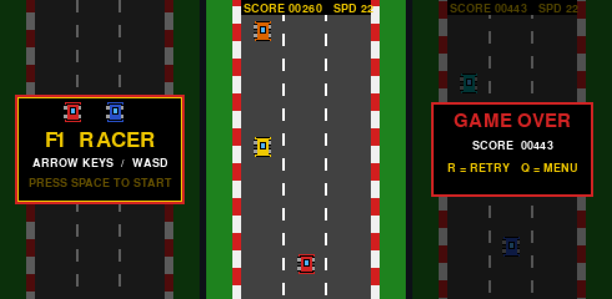

# F1 Racer

A retro, NES-style top-down racing game made with **Python** and **Pygame**. Weave between rival cars across three lanes for as long as you can while the race keeps getting faster.



## Features

- Chunky pixel-art look: the game renders at 160×240 and is scaled up 3×
- Every car, kerb and lane marking is drawn in code, with no image assets
- Difficulty ramps up with your score: rivals get faster and spawn more often, and your car gets quicker to keep up
- Scrolling road with animated red and white kerbs
- Title screen, live score and speed HUD, explosion effect and game over screen

## Controls

| Key | Action |
|---|---|
| `←` `→` or `A` `D` | Steer |
| `Space` / `Enter` | Start |
| `R` | Retry after a crash |
| `Q` / `Esc` | Back to the title screen after a crash |

## Getting started

Requires **Python 3.8+**.

```bash
git clone https://github.com/aziz-hizem/f1-racer.git
cd f1-racer
pip install -r requirements.txt
python f1_racer.py
```

## How it works

- The whole game is drawn onto a small off-screen `Surface`, which is scaled up to the window every frame. That gives the pixelated retro look without needing sprite art.
- Scrolling is faked: the road stays still while the kerb stripes and lane dashes are offset by a scroll counter, and rival cars move down the screen at the current race speed.
- Difficulty is a function of the score: rival speed rises every 250 points, the spawn interval shrinks every 120 points (down to a minimum), and the player's steering speed rises every 500 points.
- Collisions use simple axis-aligned hit boxes around each car.

## License

[MIT](LICENSE)
